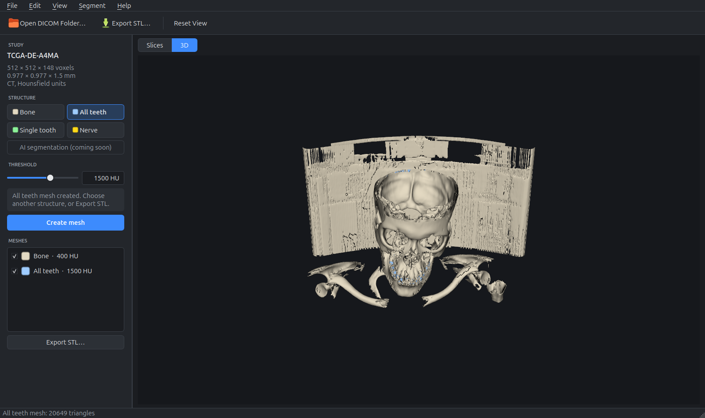
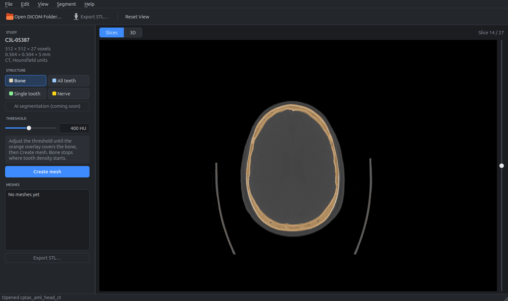
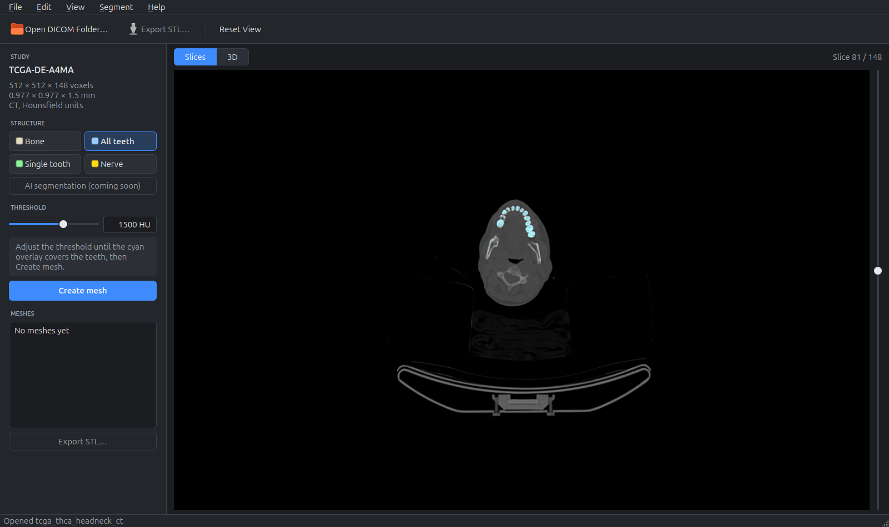
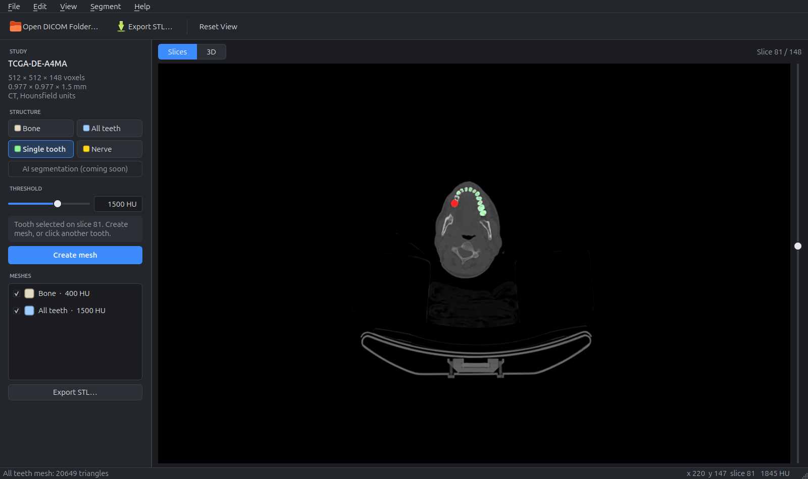
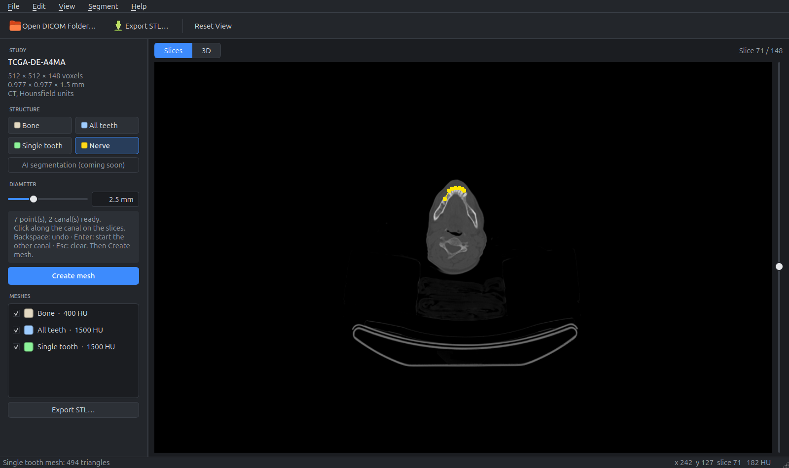
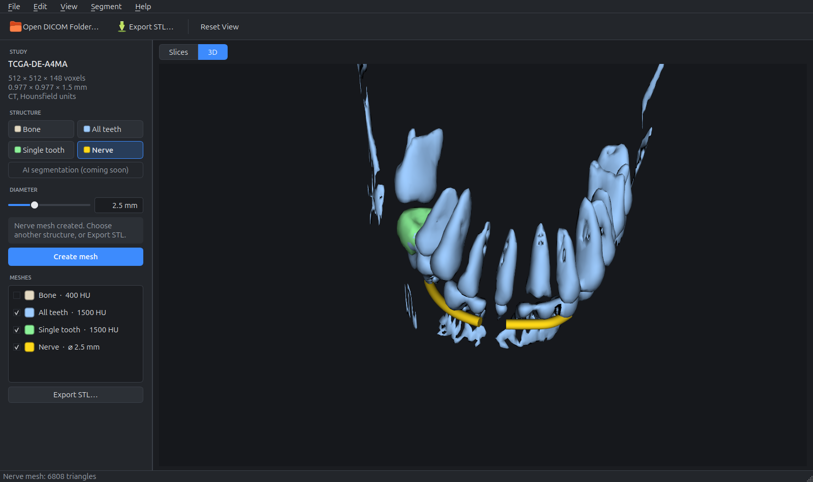
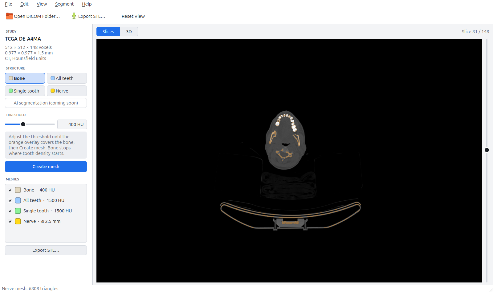
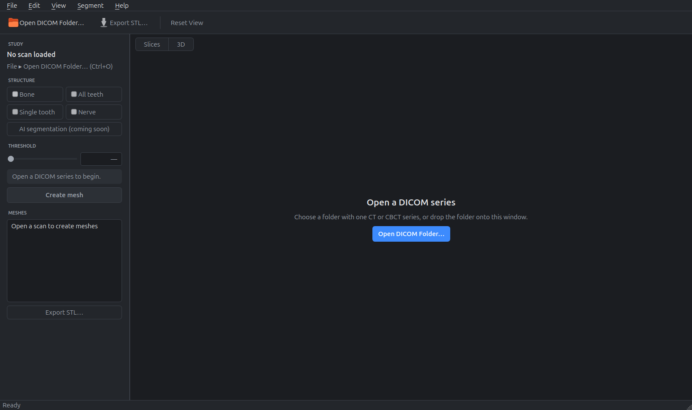
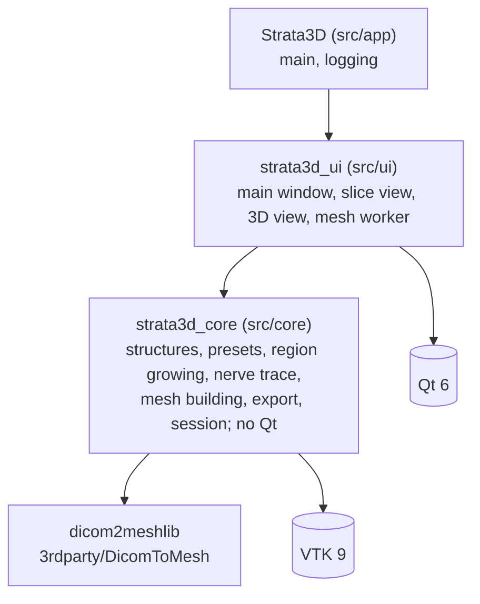

<p align="center">
  
</p>

<h1 align="center">Strata3D</h1>

<p align="center">
  <b>From CT and CBCT slices to 3D models of bone, teeth and nerve canals.</b>
</p>

<p align="center">
  
  
  
  
</p>

Strata3D is a desktop application that opens a DICOM series (CT or cone-beam CT),
lets you segment anatomical structures directly on the slices, and exports each
structure as its own STL mesh for 3D printing, surgical planning or further CAD work.

> **Not a medical device.** Strata3D is not cleared for clinical use. Use it for
> research, education and engineering work.



## Contents

- [Why Strata3D](#why-strata3d)
- [Screenshots](#screenshots)
- [Features](#features)
- [Quick start](#quick-start)
- [Usage](#usage)
- [Technology](#technology)
- [Architecture](#architecture)
- [Project structure](#project-structure)
- [Configuration](#configuration)
- [Testing](#testing)
- [Build and distribution](#build-and-distribution)
- [Roadmap](#roadmap)
- [Contributing](#contributing)
- [License](#license)
- [Credits](#credits)

## Why Strata3D

Turning a scan into printable anatomy usually means a large commercial segmentation
suite or a general-purpose research tool. Strata3D focuses on one job: get from a
DICOM folder to clean, correctly oriented STL files for the structures you need, with
the slice view showing exactly what will be meshed before you build it.

It is aimed at engineers, researchers and dental/maxillofacial teams who need models
of bone, teeth or the mandibular nerve canal from CT or CBCT. Automatic AI
segmentation is planned; today every structure is segmented with interactive,
explainable tools (thresholds, click-to-select, manual tracing).

## Screenshots

All screenshots are captured from the running application by its UI test
(`strata3d_ui_test --screenshots`) on a real, public, de-identified head and neck CT
from The Cancer Imaging Archive ([example/README.md](example/README.md)).

| | |
|---|---|
|  |  |
| **Bone threshold.** The orange overlay shows exactly which voxels the bone mesh will contain. | **All teeth.** A higher threshold isolates tooth density (cyan). |
|  |  |
| **Single tooth.** Click a tooth (red marker); only the region connected to it is meshed. | **Nerve tracing.** Points placed along the mandible below the teeth (an illustration of the tool, not a verified canal). |
|  |  |
| **3D view.** Teeth, the selected tooth (green) and the traced nerve, bone hidden. Each mesh can be shown or hidden. | **Light theme.** Dark is the default; View ▸ Theme switches. |

<details>
<summary>Start screen</summary>



</details>

## Features

**Scans**
- Opens a folder containing one DICOM series (uncompressed CT or CBCT); also by drag and
  drop or from the recent-scans list.
- Reads CT in Hounsfield units; detects uncalibrated CBCT gray values.
- Reading runs in the background; the window stays responsive.
- Slice view with scroll, zoom, pan and contrast; the status bar shows the voxel and its
  value under the mouse.

**Segmentation (no AI required)**

| Structure | Method |
|---|---|
| Bone | Threshold (starts at 400 HU on CT, estimated from the histogram on CBCT), live overlay. Stops where tooth density starts, so bone and teeth do not overlap. |
| All teeth | Threshold (starts at 1500 HU on CT), live overlay. |
| Single tooth | Threshold, then click the tooth. The connected region is grown from the click; thin contacts to neighbouring teeth are cut first. |
| Nerve | Click points along the canal on the slices; a smooth tube of adjustable diameter (1–6 mm) is built through them. Two canals supported. |

**Meshes and export**
- Meshes are built on a worker thread, cleaned (small fragments removed), reduced and
  smoothed.
- 3D view with one colored mesh per structure; show, hide or delete each.
- **Export STL** writes `bone.stl`, `teeth.stl`, `tooth.stl` and `nerve.stl` (binary) into
  a timestamped folder. Meshes are upright in the scan's patient axes and share one
  coordinate frame, so they line up when imported together.

**Desktop application**
- Menus, toolbar, keyboard shortcuts (Help ▸ Keyboard Shortcuts), dark and light themes.
- Remembers window layout, theme, last folder and recent scans.
- Marks unexported work in the title bar and asks before it would be lost.

## Quick start

Tested on **Ubuntu 26.04**. Install the dependencies, build, and open the example CT:

```bash
sudo apt install build-essential cmake git qt6-base-dev libvtk9-dev libvtk9-qt-dev \
                 libgl1-mesa-dev libdcmtk-dev
git clone --recurse-submodules git@github.com:hamzaqureshi5/dicom-segmentation.git strata3d
cd strata3d
cmake -S . -B build
cmake --build build -j"$(nproc)"
./build/Strata3D example/downloads/tcga_thca_headneck_ct
```

`libdcmtk-dev` is only needed for the synthetic test-data generator. Already cloned
without submodules? Run `git submodule update --init`. Other platforms need the same
libraries (see [docs/development.md](docs/development.md)); they have not been tested.

## Usage

1. **Open a scan**: File ▸ Open DICOM Folder (Ctrl+O), drop a folder on the window, or
   pass the folder on the command line.
2. **Choose a structure** in the sidebar (Ctrl+1 to Ctrl+4).
3. **Adjust it on the slices**: move the threshold until the overlay covers the
   structure; for a single tooth click the tooth; for the nerve click along the canal.
4. **Create mesh** (Ctrl+Enter). The 3D view opens; repeat for other structures.
5. **Export STL** (Ctrl+E) and choose a folder.

The [user guide](docs/user-guide.md) covers each tool, mouse controls and all shortcuts.

## Technology

| Technology | Role |
|---|---|
| C++17 | Application and libraries |
| Qt 6 (Widgets, OpenGLWidgets, Concurrent) | Window, layouts, menus, theming, settings, background loading |
| VTK 9 | DICOM reading, image display, marching cubes, mesh filters, 3D rendering, STL export; `QVTKOpenGLNativeWidget` embeds VTK in Qt |
| [DicomToMesh](https://github.com/AOT-AG/DicomToMesh) (git submodule) | `dicom2meshlib`: iso-surface extraction and mesh cleanup routines |
| DCMTK (optional) | Writes the synthetic test series (`tools/dental_phantom`) |
| CMake ≥ 3.17 | Build system |
| GoogleTest, Qt Test | Library tests and the end-to-end UI test |

## Architecture



The segmentation rules live in a Qt-free core that is unit-tested on its own; the UI
layer presents them and keeps heavy work off the UI thread (scans are read on a loader
thread, meshes built on a worker thread). [docs/architecture.md](docs/architecture.md)
describes the layers, data flow, error handling and coordinates;
[docs/adr](docs/adr/) records the main decisions.

## Project structure

```text
.
├── src/
│   ├── app/          main(), logging setup
│   ├── core/         segmentation domain (VTK only, no Qt)
│   └── ui/           main window, views, worker, theme, settings (+ main_window.ui)
├── tests/
│   ├── unit/         GoogleTest tests of the core
│   └── ui/           end-to-end UI test and screenshot capture
├── 3rdparty/
│   └── DicomToMesh/  git submodule: dicom2meshlib (and the upstream CLI)
├── tools/            dental_phantom: synthetic dental DICOM generator
├── example/          example DICOM series (real CT and phantoms)
└── docs/             user guide, architecture, ADRs, development guide, images
```

## Configuration

Strata3D needs no configuration files, services or credentials. Preferences are stored
with `QSettings` (on Linux in `~/.config/Strata3D/Strata3D.conf`): window layout, theme,
last folder and recent scans. Delete that file to reset them.

At build time, the optional environment variables `QTDIR` and `VTK_DIR` point CMake at
non-standard Qt and VTK installations.

## Testing

```bash
cmake -S . -B build -DSTRATA3D_BUILD_TESTS=ON
cmake --build build -j"$(nproc)"
./build/strata3d_unit_tests          # 35 tests of the core, no display needed
./build/strata3d_ui_test             # end-to-end UI checks (needs a display)
```

Run them from the repository root; they read `example/`.
Details in [docs/development.md](docs/development.md#tests).

## Build and distribution

`cmake --build build` produces `build/Strata3D` and, when DCMTK is installed,
`build/dental_phantom`. `-DSTRATA3D_BUILD_DICOM2MESH_CLI=ON` also builds the upstream
`dicom2mesh` command-line converter. There are no installers or release packages yet;
see the roadmap.

## Roadmap

**Done**
- Linux build on Qt 6 / VTK 9; Wayland and NVIDIA fixes.
- Interactive segmentation of bone, all teeth, a single tooth and the nerve canal.
- One STL per structure, upright in patient axes.
- Redesigned desktop UI: themes, shortcuts, background loading, persistence.
- Example data, synthetic dental phantom, unit and end-to-end UI tests.
- Layered architecture (Qt-free core), structured logging, dicom2mesh as a submodule.

**In progress**
- AI segmentation: a model is being trained separately; the button is in place but not
  connected.

**Planned**
- Crop box (region of interest) to exclude the scanner table and other structures.
- Coronal, sagittal and curved (panoramic) views; better nerve tracing.
- Manual editing (brush, eraser, undo) to correct thresholds and AI results.
- Compressed DICOM and multi-series folders (via vtk-dicom's reader).
- Meshes in DICOM patient coordinates (ImagePositionPatient), for alignment with
  intraoral scans.
- Measurements (distance, angle, density) and mesh repair for printing.
- Windows and macOS verification, installers.

## Contributing

See [CONTRIBUTING.md](CONTRIBUTING.md) for setup, coding conventions and the pull
request checklist. Report bugs and request features through the repository's
[issues](../../issues).

## License

**No license has been chosen for Strata3D yet.** Until one is added, all rights are
reserved by the repository owner.

Third-party parts keep their own licenses:
- `3rdparty/DicomToMesh` is [DicomToMesh](https://github.com/AOT-AG/DicomToMesh) by
  Adrian Schneider (MIT License), included as a git submodule. `src/ui/mesh_worker.*`
  derives from its GUI code and keeps its MIT notice.
- The example CT is from TCIA's TCGA-THCA collection (CC BY 3.0); attribution and data
  use conditions are in [example/README.md](example/README.md).

## Credits

Built with [Qt](https://www.qt.io/), [VTK](https://vtk.org/) and
[DCMTK](https://dicom.offis.de/).
Mesh routines from DicomToMesh. DICOM is a registered trademark of NEMA.
