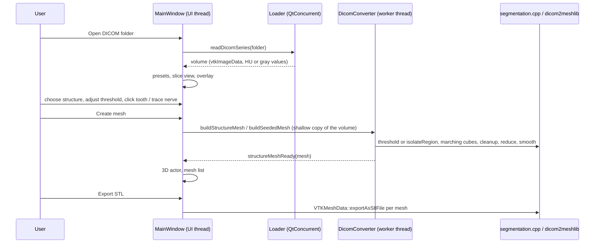

# Architecture

Strata3D is a single C++17 executable built from three parts:

| Part | Location | Depends on | Responsibility |
|---|---|---|---|
| Application | `src/`, `include/`, `forms/` | Qt 6, VTK, dicom2meshlib | Main window, workflow, segmentation tools, theme |
| dicom2meshlib | `lib/` | VTK only | DICOM/PNG loading, marching cubes, mesh cleanup, mesh import/export |
| dicom2mesh CLI | `dicom2mesh/` | dicom2meshlib | Command-line converter (upstream tool) |

`gui/` holds the upstream dicom2mesh GUI for reference; it is not built.

## Threads and data flow

- The **UI thread** only builds the interface, renders and reacts to input.
- **Reading** a scan runs through `QtConcurrent::run(readDicomSeries)`; a
  `QFutureWatcher` calls `MainWindow::loadFinished` on the UI thread.
- **Meshing** runs in `DicomConverter`, a `QObject` moved to `m_conversionThread`.
  `MainWindow` emits `doBuildStructureMesh` / `doBuildSeededMesh`; queued connections
  carry `vtkSmartPointer` types (registered with `qRegisterMetaType`). The worker
  receives a `ShallowCopy` of the volume, so it never shares a VTK pipeline object with
  the UI thread; voxel memory is shared read-only.
- The **nerve tube** is small and is built directly on the UI thread
  (`buildNerveTube`).

## Modules

### `MainWindow` (`src/MainWindow.cpp`, `include/MainWindow.h`)

- Layout comes from `forms/MainWindow.ui`: a splitter with a scrollable sidebar and the
  viewer area (Slices/3D switch, a stack with the start screen and the VTK widget, slice
  slider).
- Menus, toolbar, status bar and shortcuts are created in code (`createActions`,
  `createStatusBar`). `updateActions` enables commands from the current state (scan
  loaded, busy, selected structure, nerve points).
- One `QVTKOpenGLNativeWidget` shows either the slice render window
  (`vtkImageViewer2` + overlay + markers) or the 3D render window (one actor per mesh).
- Slice view: an `vtkImageThreshold` → lookup table → `vtkImageActor` overlay previews the
  selected range (streaming, only the visible slice is computed). A render
  `StartEvent` observer (`syncSliceUi`) keeps the overlay, markers, slice label and
  slider in sync. An interactor observer at priority 1 handles clicks and keys for the
  single-tooth and nerve tools before the interactor style sees them, and tracks the
  mouse for the value readout.
- Persistence (`QSettings`), unexported-work tracking (`setUnexported`,
  `confirmDiscardMeshes`), export (`exportStructures`).

### `segmentation.cpp` (`include/segmentation.h`)

Pure VTK functions without UI:

- `estimateThresholdPresets`: 400 / 1500 HU on CT; on uncalibrated data three nested
  Otsu splits of the histogram (air | soft tissue | bone | teeth).
- `isolateRegion`: single tooth. Threshold → erode (cuts thin contacts) → seeded
  connectivity from the clicked voxel → dilate back → AND with the threshold → mask
  the volume for the iso-surface.
- `buildNerveTube`: spline through the traced points → capped tube of the chosen
  diameter.

### `DicomConverter` (`src/dicomConverter.cpp`)

`buildStructureMesh` (threshold, optional upper bound so bone stops at tooth density)
and `buildSeededMesh` (single tooth) run marching cubes and the cleanup chain: remove
fragments smaller than 2 % of the largest part, reduce triangles by 50 %, 20 smoothing
iterations. There is no centering, so all meshes share one frame.

### `theme.cpp` (`include/theme.h`)

Design tokens (colors for dark and light, spacing, radii) and the single application
style sheet and palette on Qt's Fusion style. Widgets pick variants through a `role`
dynamic property (`primary`, `section`, `muted`, `title`, `hint`, `structure`,
`segment`); there are no per-widget style sheets.

### dicom2meshlib (`lib/`)

`VTKDicomRoutines` (load DICOM/PNG, `dicomToMesh`), `VTKMeshRoutines` (reduce, remove
small objects, smooth, center), `VTKMeshData` (STL/OBJ/PLY import and export). No Qt.

## Coordinates and orientation

`vtkDICOMImageReader` applies RescaleSlope/Intercept, so CT values arrive in Hounsfield
units, but it flips image rows and reverses the slice order. `readDicomSeries` flips both
back. Voxel index axes then follow DICOM for axial scans: x towards the patient's left,
y towards the back, z up (superior). Meshes are in millimetres relative to the volume
corner; ImagePositionPatient is not applied yet.

The slice camera looks from the feet with the front at the top (radiological view). The
3D camera starts facing the patient from the front, slightly above.

## Platform notes

These are required for the GUI to work on Linux (see `CLAUDE.md` for details):

- `QSurfaceFormat::setDefaultFormat(QVTKOpenGLNativeWidget::defaultFormat())` before
  `QApplication` (OpenGL 3.2 core context; NVIDIA rejects VTK's shaders otherwise).
- A VTK object-factory override makes every `vtkRenderWindow` a
  `vtkGenericOpenGLRenderWindow`; VTK's own X11 window crashes on Wayland.
- Executables that render with VTK 9 need `vtk_module_autoinit` in CMake.
