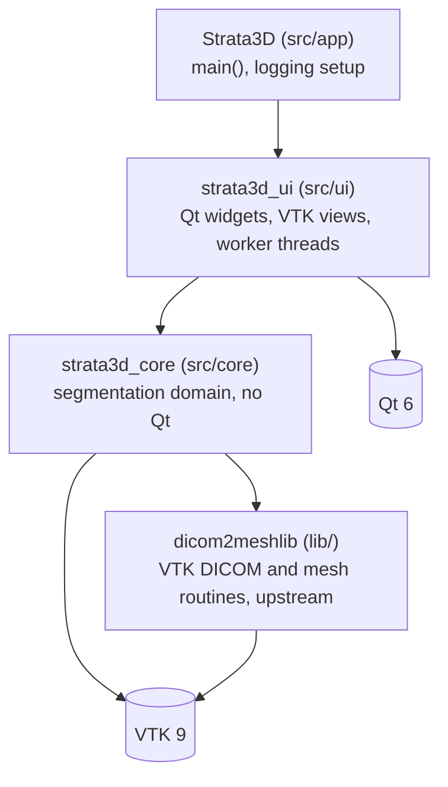
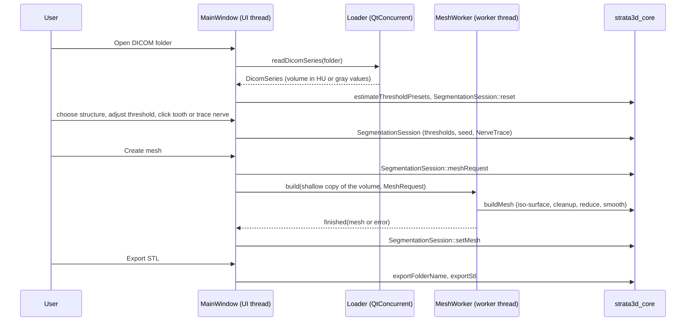

# Architecture

Strata3D is one C++17 executable built from layered libraries. Each layer only
depends on the layers below it; CMake targets enforce this.

| Target | Location | Depends on | Responsibility |
|---|---|---|---|
| `strata3d_core` | `src/core/` | VTK, dicom2meshlib | Structures and their rules, threshold presets, DICOM reading, region growing, nerve trace, mesh building, STL export, per-scan session state |
| `strata3d_ui` | `src/ui/` | core, Qt 6 | Main window, slice and 3D views, mesh worker thread, theme, settings, logging categories |
| `Strata3D` | `src/app/` | ui | `main()`, logging setup |
| `dicom2meshlib` | `lib/` | VTK | Upstream dicom2mesh routines (marching cubes, mesh cleanup, mesh I/O) |
| `dicom2mesh` | `dicom2mesh/` | dicom2meshlib | Upstream command-line converter |

The core has no Qt dependency, so its rules are unit-tested without a window
(`tests/unit`). Architectural decisions are recorded in [docs/adr](adr/).

## Threads and data flow

- The **UI thread** builds the interface, renders and reacts to input.
- **Reading** runs through `QtConcurrent::run(readDicomSeries)`; a
  `QFutureWatcher` calls `MainWindow::loadFinished` on the UI thread.
- **Meshing** runs in `MeshWorker`, moved to its own `QThread`. Queued signals carry
  `vtkSmartPointer` and `MeshRequest` values (declared in `ui/meta_types.h`). The worker
  receives a `ShallowCopy` of the volume, so it never shares a VTK pipeline object with
  the UI thread; the voxel memory is shared read-only.
- The **nerve tube** is small and is built on the UI thread.

## Core (`src/core`)

Plain functions and small classes on VTK types. No UI, no threads, no global state.

| File | Contents |
|---|---|
| `structures` | `StructureId`, the table of names, export file names and colors, and the rule "bone stops where tooth density starts" (`thresholdRange`) |
| `presets` | `estimateThresholdPresets` (400 / 1500 HU on CT; nested Otsu splits on uncalibrated data) and `defaultDisplayWindow` |
| `dicom_series` | `readDicomSeries`: reads a folder, undoes `vtkDICOMImageReader`'s flips, reports errors instead of throwing |
| `region_growing` | `isolateRegion`: single tooth (threshold → erode → seeded connectivity → dilate → mask) |
| `nerve_trace` | `NerveTrace` (points, undo, next canal) and `buildNerveTube` |
| `mesh_builder` | `buildMesh(volume, MeshRequest, MeshSettings, callbacks)`; all tuning values in `MeshSettings` |
| `stl_export` | `exportFolderName`, `exportStl` |
| `segmentation_session` | Per-scan state: thresholds, tooth seed, nerve trace and diameter, meshes, unexported flag; validates what a mesh request needs |

## UI (`src/ui`)

| File | Responsibility |
|---|---|
| `main_window` (+ `.ui`) | Shell: menus, toolbar, sidebar, status bar; turns user actions into session, view and worker calls and presents the result |
| `slice_view` | `vtkImageViewer2`, threshold overlay, tooth/nerve markers; converts clicks, keys and mouse moves into signals |
| `slice_interactor_style` | Wheel and Up/Down change the slice |
| `mesh_view` | 3D renderer with one actor per structure, visibility, camera |
| `mesh_worker` | Thread wrapper around `strata3d::buildMesh` |
| `app_settings` | Typed access to `QSettings` (theme, last folder, recent scans, window layout) |
| `theme` | Design tokens and the application style sheet |
| `log`, `meta_types` | Logging categories; types used across threads |

`MainWindow` owns the session, the two views and the worker. The views know nothing
about structures or rules: they draw what they are given (`showOverlay(range, color)`,
`setToothMarker`, `setNerveTrace`) and report input (`voxelClicked`,
`traceKeyPressed`, `cursorMoved`, `sliceChanged`).

## Errors and logging

- Expected failures are values, not exceptions: `DicomSeries::error`,
  `MeshResult::error`, `ExportResult`, and the `reason` from
  `SegmentationSession::meshRequest`. The UI shows them in the hint box (fixable by the
  user) or a dialog (load and export failures).
- Unexpected exceptions (for example `std::bad_alloc` on a huge scan) are caught at the
  thread boundaries (`readDicomSeries`, `buildMesh`) and turned into error messages.
- Logging uses Qt categories `strata3d.load`, `strata3d.mesh`, `strata3d.ui` and
  `strata3d.vtk` with a timestamped format. VTK's own warnings and errors are routed into
  `strata3d.vtk` instead of being printed directly. Enable debug output with
  `QT_LOGGING_RULES="strata3d.*.debug=true"`.
- `dicom2meshlib` still prints progress with `std::cout` (upstream code).

## Coordinates and orientation

`vtkDICOMImageReader` applies RescaleSlope/Intercept, so CT values arrive in Hounsfield
units, but it flips image rows and reverses the slice order. `readDicomSeries` flips both
back. Voxel axes then follow DICOM for axial scans: x towards the patient's left, y
towards the back, z up. Meshes are in millimetres relative to the volume corner;
ImagePositionPatient is not applied.

The slice camera looks from the feet with the front at the top (radiological view). The
3D camera starts facing the patient from the front, slightly above.

## Platform notes

- `QSurfaceFormat::setDefaultFormat(QVTKOpenGLNativeWidget::defaultFormat())` before
  `QApplication` (OpenGL 3.2 core; NVIDIA rejects VTK's shaders otherwise).
- A VTK object-factory override in `main_window.cpp` makes every `vtkRenderWindow` a
  `vtkGenericOpenGLRenderWindow`; VTK's own X11 window crashes on Wayland.
- Every target that renders with VTK 9 gets `vtk_module_autoinit` in CMake.
